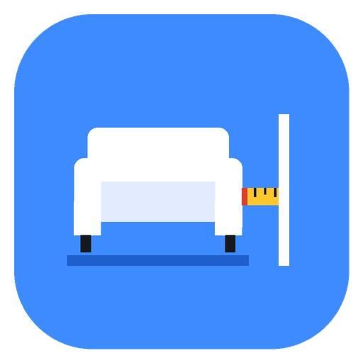
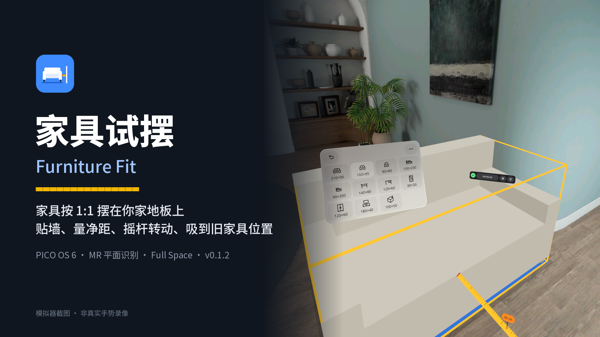
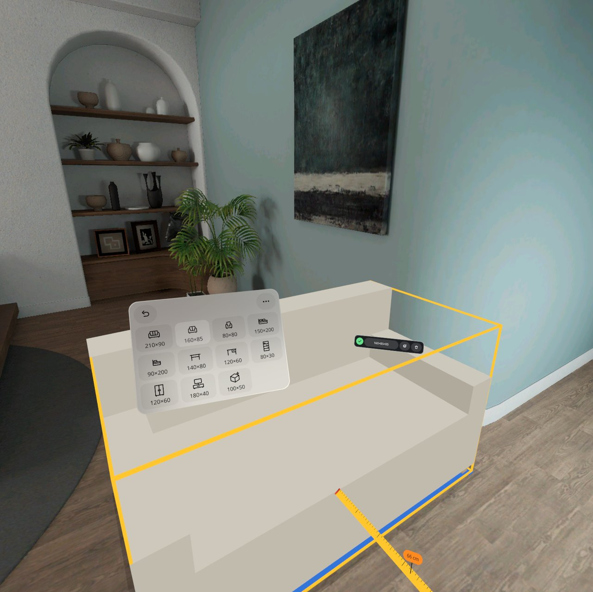
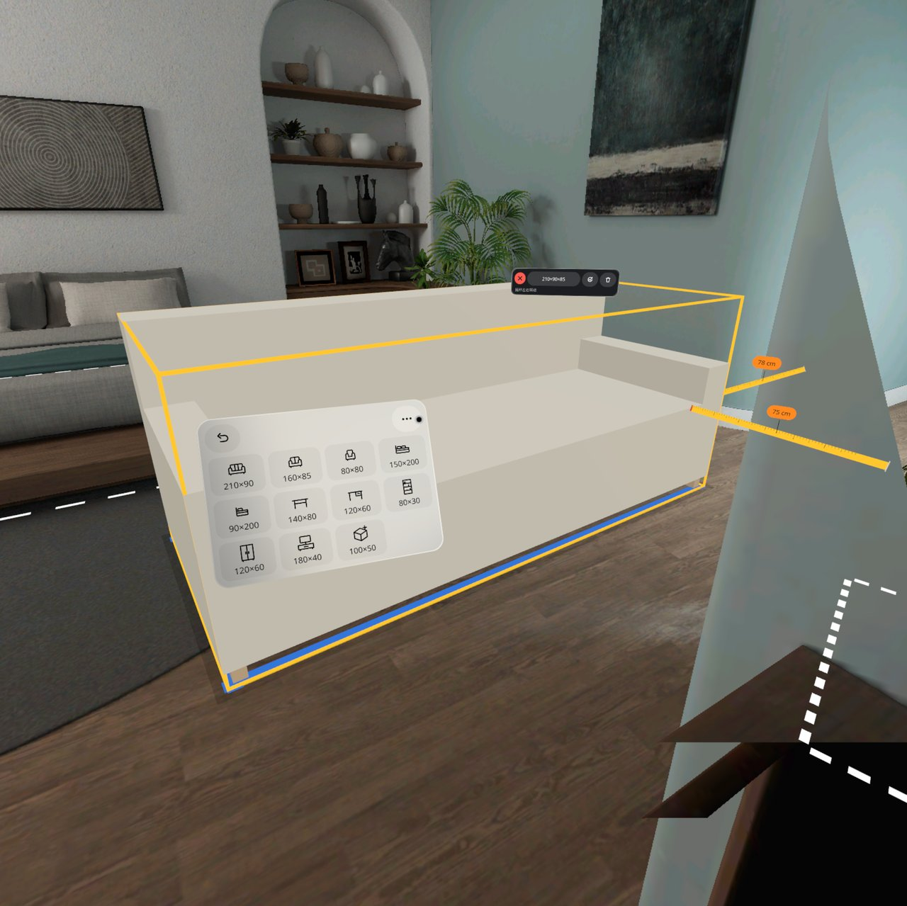
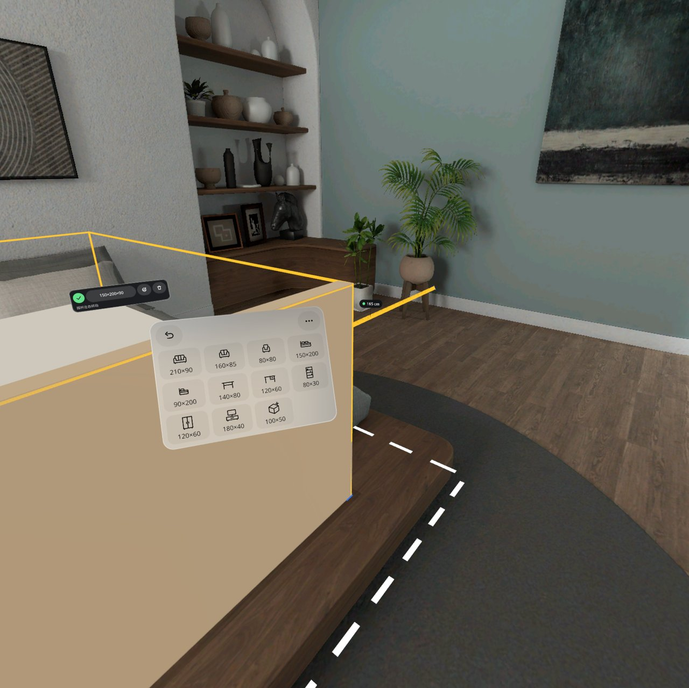
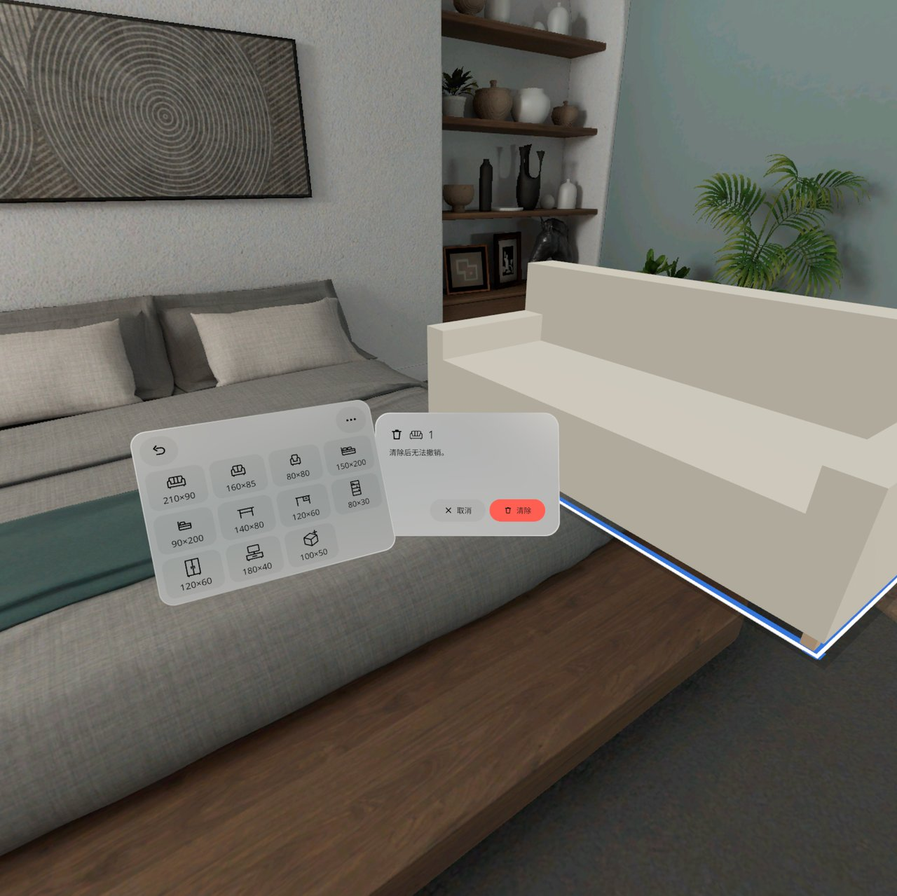
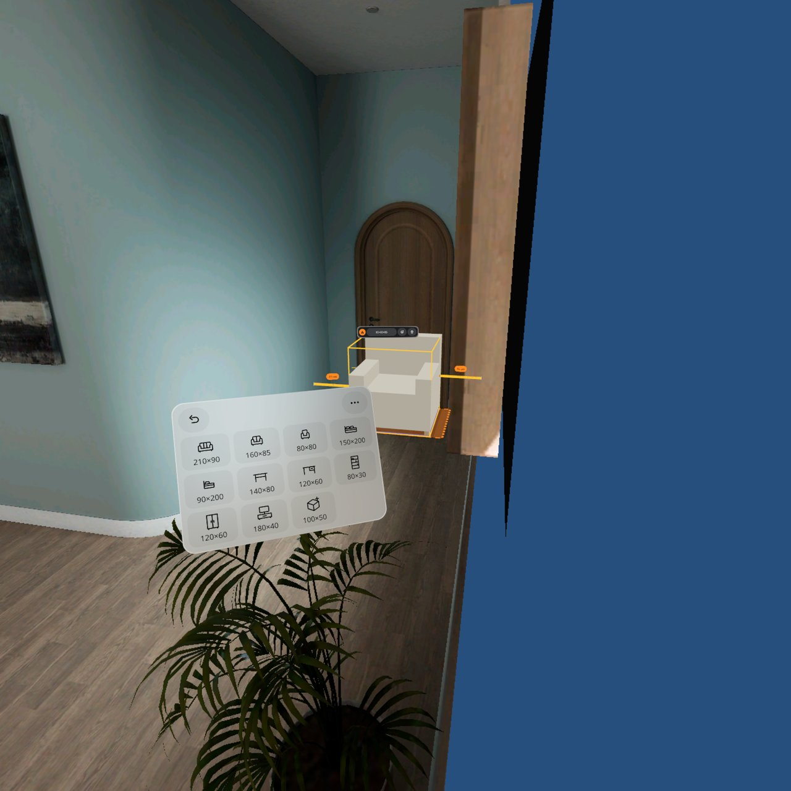
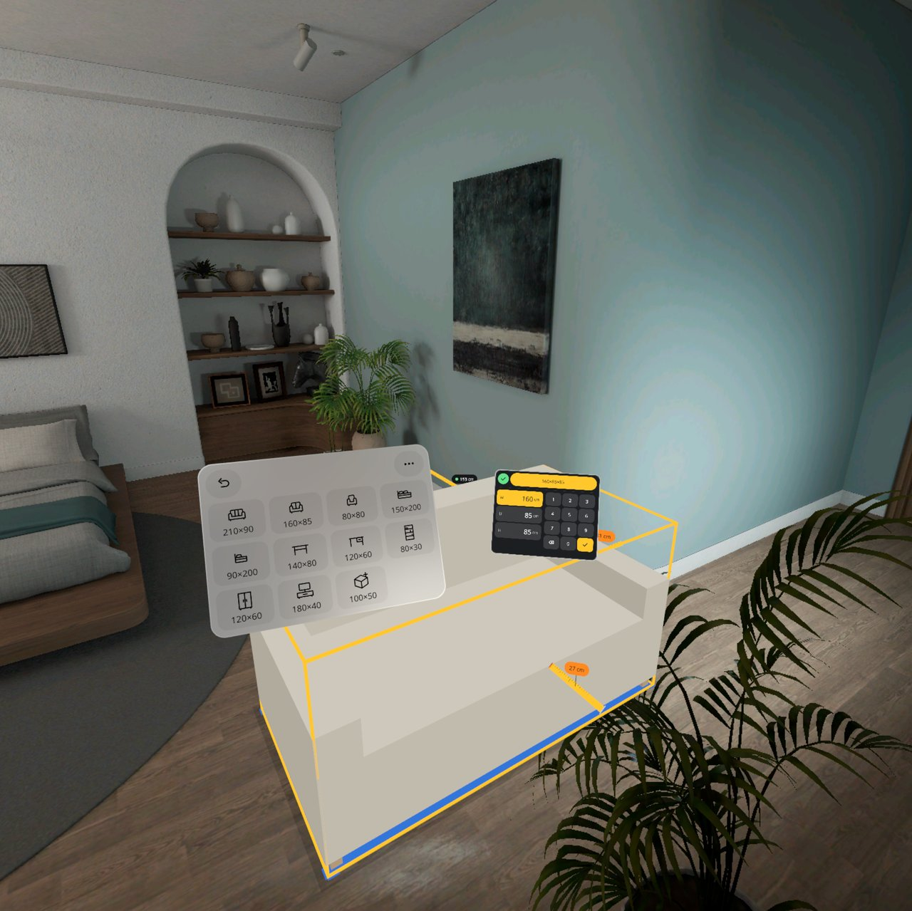

# 家具试摆 Furniture Fit



1.6 米的沙发放得下吗？在家具库里点一下，它就按 1:1 落在你家地板上；按住拖到墙边会自动贴上，四边拉出黄色卷尺，告诉你还剩几厘米、人走不走得过去。推手柄摇杆就能原地转动；拖到旧家具的位置，它会吸到那件真家具的虚线轮廓上，直接比大小。撞到墙、别的家具或真实家具时变红，挡住门变橙。PICO OS 6 的 MR 应用，只在 Full Space 里运行。

Will a 1.6 m sofa fit? Tap a tile and the piece lands 1:1 on your real floor. Hold and drag it to a wall and it snaps flush; yellow tapes on every side read the clearance left, so you can tell whether people can still walk past. Push the controller thumbstick to turn it in place; drag it onto an old piece of furniture and it snaps to that piece's dashed outline, so you can compare sizes directly. It turns red when it goes into a wall, another piece or real furniture, and orange when it blocks a door. An MR app for PICO OS 6, Full Space only.



> **当前状态 / Status (v0.1.2)**
>
> - v0.1.2 在 PICO 6.1 模拟器上验证过（QA 第 3 轮通过）。**还没装到头显上**：头显里现在是 v0.1.1，v0.1.2 要等用户插上头显自己装、自己验。v0.1.2 passed QA round 3 on the PICO 6.1 emulator. **It is not on a headset yet**: the headset still has v0.1.1, and v0.1.2 waits for the user to install and check it.
> - **家具在真实房间里的落点精度、摇杆手感和吸附范围都没有在真机上验证。** Placement accuracy in a real room, thumbstick feel and snap range have not been checked on a device.
> - 有 4 个已知小问题（见下文「已知问题」）。There are 4 known minor issues (see below).
> - 截图和视频都来自模拟器，由调试命令和模拟器输入驱动，**不是真实手势录像**。Screenshots and video come from the emulator, driven by debug commands and injected emulator input. **This is not a recording of real hand gestures.**

## v0.1.2 新增 What's new

- **摇杆转动**：选中家具后，左右推手柄摇杆（X 轴），家具绕自己的竖直中轴转动，满推约 90°/s；件条上多了一行提示「摇杆左右转动」。Thumbstick turn: with a piece selected, push the stick left or right and it turns around its vertical axis (about 90°/s at full push). The strip shows a "turn with the thumbstick" hint.
- **吸附真家具的虚线框**：空间网格认出的真实家具在地上画白色虚线轮廓。把家具拖或转到轮廓附近（中心 20 cm、朝向 12° 以内）会吸上去，黄色闪一下，算作替换那件真家具，不再判「撞了」。Snap to real furniture: real furniture found in the spatial mesh is drawn as a dashed outline on the floor. Bring a piece within 20 cm and 12° and it snaps on, flashes yellow, and counts as replacing that piece instead of colliding with it.
- **对话框打开时家具库让开**：「全部清除」和「空间能力不可用」对话框打开时，如果家具库挡在前面，它会滑到对话框旁边，关掉后回原位。The library slides aside when it would hide the "Clear all" or "Spatial features unavailable" dialog, and slides back when the dialog closes.
- 修了 v0.1.0 的 3 个问题：英文不可用对话框标题现在两行完整显示；低头时提示条按真实视线摆放，看得见；定位丢失时所有家具都变灰。Fixed the three v0.1.0 issues: the English dialog title shows on two lines; hint bars follow the real gaze when you look down; every piece turns grey when tracking is lost.

## 截图 Screenshots

| | |
| --- | --- |
|  |  |
| **点格子放下**：双人沙发 1:1 落在视线前方地板上并选中，卷尺读出到旁边的净距 66 cm。Tap a tile: the loveseat lands on the floor, selected, with a 66 cm clearance tape. | **摇杆转动**：推摇杆，沙发绕中轴原地转。Turning a sofa in place with the thumbstick. |
|  |  |
| **吸到真床轮廓**：双人床拖到房间里真床的白色虚线框上，吸附后恢复正常颜色，件条显示绿勾。A double bed snapped onto the real bed's outline. | **对话框打开时家具库让开**：家具库滑到左边，「全部清除」确认框完整可点。The library slides aside so the "Clear all" dialog is fully visible. |
|  |  |
| **挡门**：门前 0.8 m 出现橙色区域，件条显示警告。Blocking a door: an orange zone in front of the door. | **改尺寸**：宽 / 深 / 高三行 + 数字键盘。Resize: width, depth and height with a keypad. |

第 1、5、6 张是 v0.1.0 的截图（那部分界面没变，件条在 v0.1.2 多了一行摇杆提示）；第 2 张是 v0.1.1；第 3、4 张是 v0.1.2。Shots 1, 5 and 6 are from v0.1.0 (unchanged apart from the extra hint row on the strip), shot 2 from v0.1.1, shots 3 and 4 from v0.1.2.

演示视频 Demo video: [docs/media/FurnitureFit-demo.mp4](docs/media/FurnitureFit-demo.mp4)（60 s，v0.1.1，PICO 模拟器，调试输入驱动，无声，**非真实手势录像** / emulator, debug-driven, silent, not real gestures）。摇杆和吸附部分与 v0.1.2 相同。The thumbstick and snap parts are the same in v0.1.2.

## 怎么用 How it works

1. 打开应用，慢慢看一圈房间，等地板和墙被识别出来。Open the app and look around until the floor and walls are found.
2. 家具库有 11 个格子：三人沙发、双人沙发、单人椅、双人床、单人床、餐桌、书桌、书柜、衣柜、电视柜、自定义。点一个，它就落在你前方约 1.4 m 的地板上。The library has 11 tiles (sofas, beds, tables, storage, custom). Tap one and it lands about 1.4 m ahead.
3. 按住家具拖动；靠近墙会自动贴上，靠近真家具的虚线框会吸上去。左右推摇杆原地转动；件条还可以转 90°、改尺寸、删除。Hold and drag; it snaps to walls and to real-furniture outlines. Push the thumbstick to turn it; the strip also rotates by 90°, resizes and removes.
4. 四边的黄色卷尺显示净距：≥ 80 cm 是绿点（人走得过去），5–80 cm 橙底。The tapes show the clearance: green dot from 80 cm, orange from 5 to 80 cm.
5. 红 = 撞了（墙、别的家具、空间网格识别出的真实家具）；橙 = 挡门。Red = collides; orange = blocks a door.
6. 摆法自动保存在本机：一个房间锚点 + 每件家具的相对位置。下次在同一个房间打开，家具从地板上升起回到原位。最多 12 件。The layout is saved on the headset (one room anchor plus local poses) and comes back next time in the same room. Up to 12 pieces.

全程离线，不联网，不需要账号或 API key。中文 / 英文界面，厘米 / 英寸单位。Fully offline, no account, no API key. Chinese and English; cm and inches.

## 安装 Install

```bash
adb install -r FurnitureFit-v0.1.2.apk
pico-cli app launch io.embodit.furniturefit
```

APK 在 [Releases](../../releases) 里（debug 签名）。The APK is attached to the release (debug-signed).

## 构建 Build

```bash
./gradlew assembleDebug
adb install -r app/build/outputs/apk/debug/app-debug.apk
```

Needs the PICO Spatial SDK 6.1.9 (`PICO_HOME`) and JDK 21. 42 JVM tests: `./gradlew testDebugUnitTest`.

## 已知问题 Known issues (v0.1.2)

QA 第 3 轮列出的小问题，不挡发布：
Minor issues listed by QA round 3; they do not block the release:

1. **墙角处用摇杆转动可能被推开**。家具贴墙或在墙角时转动，按「转完穿墙就沿墙推出」的规则，可能一下被推开几十厘米（第 2 轮见到一次 0.69 m）。墙角处的虚线框更适合拖进去吸，用摇杆转进去比较难。Turning a piece in a corner can push it out by tens of centimetres (0.69 m once in round 2), so corner outlines are easier to reach by dragging than by turning.
2. **小轮廓的吸附闪光看不见**。真实家具的轮廓比摆进去的家具小时（比如床脚只有 25×27 cm），吸附时 0.8 秒的黄色闪光会被家具挡住，只能靠颜色从红变正常来判断吸上了。When the real outline is smaller than the piece (a 25 × 27 cm bed foot, for example), the piece hides the 0.8 s yellow snap flash; only the colour change from red shows the snap.
3. **「摇杆左右转动」提示字小**。家具离人 2 米以上时不太好认。The "turn with the thumbstick" hint is small and hard to read beyond 2 m.
4. **模拟器里摇杆转动偏慢**。模拟器空闲时帧率只有 2 fps；真机帧率正常，不受影响。On the emulator the turn can be slow (it idles at 2 fps); not an issue at normal frame rates.

## 真机待验 To check on a headset

头显里现在还是 v0.1.1。插上头显后先装 v0.1.2：The headset still runs v0.1.1. Install v0.1.2 first:

```bash
pico-cli app install FurnitureFit-v0.1.2.apk
```

1. 摇杆方向是否顺手（右推 = 俯视顺时针），速度（满推约 90°/s）和死区是否合适。Stick direction (right = clockwise from above), speed and dead zone.
2. 真实房间里虚线框贴不贴真家具，吸附范围（中心 20 cm、朝向 12°）是否合适。Whether outlines match real furniture and whether the snap range feels right.
3. 转头、低头各打开一次「全部清除」和「不可用」对话框，看家具库让开得是否自然。Open both dialogs while turned and while looking down; check how the library steps aside.
4. 握着手柄时，捏合手势是否照常可用。Pinch still works while holding a controller.
5. 真实房间里家具 1:1 落地的位置精度（模拟器没有相机画面）。Placement accuracy on a real floor.
6. 贴墙吸附在真实墙面上的贴合度（±5 cm），以及贴墙那一侧的黄色短条看不看得到。Wall snapping within ±5 cm, and whether the contact bar is visible.
7. 门前 0.8 m 区域在真实门上的位置；模拟器只有 1 扇门。The door zone on real doors.
8. 重启后找回摆法（S15）和换房间（S16）在真机定位上的表现，10 s 超时是否合适。Restoring a layout and the other-room case, including the 10 s timeout.
9. 玻璃面板冷启动和快速开关时有没有黑块；平面识别 / 空间锚点是否要运行时授权。Black patches on glass panels; runtime permission for plane detection and anchors.

## 技术 Tech

- PICO Spatial SDK 6.1.9, Kotlin. One Mixed Stage (passthrough), Full Space only. All 2D UI is SpatialUI (`com.pico.spatial.ui.*`) inside `PicoTheme`; no Material.
- Room sensing: `PlaneTrackingManager` (floor, walls, doors, cabinet sides as thin slabs) and `MeshTrackingManager` (per-vertex semantics clustered into real furniture boxes and floor outlines); `WorldTrackingManager` for one room anchor.
- Fit rules in pure Kotlin (`domain/Fit.kt`): collision (SAT on the floor plane), door zones, gaps, wall snap, outline snap, push-out, rotate; panel dodging in `domain/PanelDodge.kt`. Covered by 42 JVM tests.
- Thumbstick: `platform/tracking/ControllerStick.kt` (dead zone 0.15, squared curve, 90°/s at full push).
- Per-frame work (drag, stick turn, live snap and colours, gap tapes, lazy follow) runs in one ECS system (`FitScene.onFrame`), not in Compose.
- Furniture looks are basic shapes (≤ 12 boxes per piece), no model files.

## 文档 Docs

- [design/design-package.json](design/design-package.json), [design/sample.html](design/sample.html): the accepted design package (states S1–S22, rules, panels, palette, copy) and the approved sample. The thumbstick turn, outline snap and dialog dodging were added after it, from headset feedback on v0.1.0 and QA round 2.
- [AGENTS.md](AGENTS.md): guidance for coding agents (structure, debug commands, QA screenshot list, emulator facts). Paths there that start with `../spatial-app-factory` point to the factory workspace and are not in this repo; the design files are in `design/`.
- [tools/harness/STICK.md](tools/harness/STICK.md): how to drive the controller thumbstick on the PICO emulator.

## 字体 Font

Bundled fonts Noto Sans and Noto Sans SC (subset): SIL Open Font License (`third_party/`).
